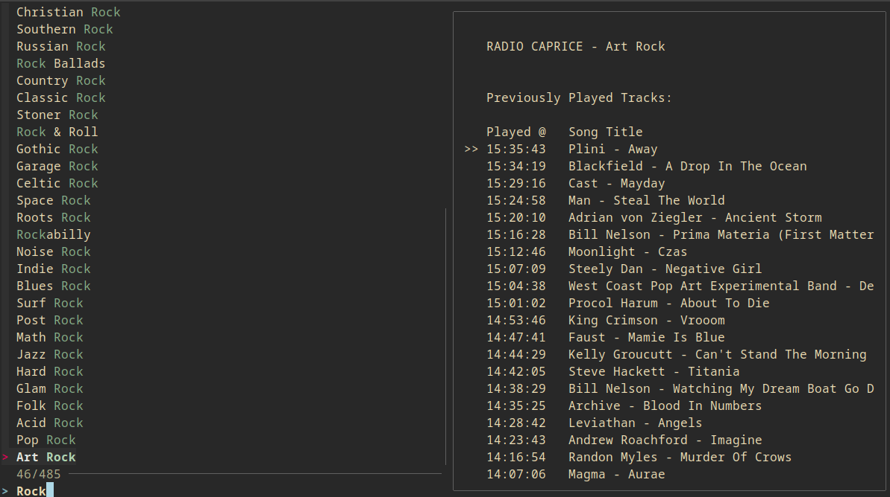
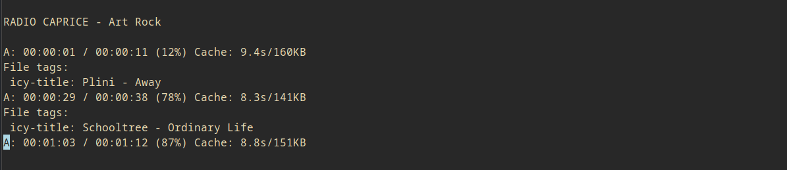

# caprice
## Terminal Frontend for the Caprice Online Radio
 
[Radio Caprice](http://radcap.ru/index-d.html) features over 500 different genres/channels, with this script you can play them all from your terminal.<br>
[fzf](https://github.com/junegunn/fzf) is used for channel selection and [mpv](https://github.com/mpv-player/mpv) for playback.<br>
Change the ``PLAYER`` and ``FINDER`` variables in the shell script to change the playback and finder tool.
The ``radios.json`` database is taken from the [Radio Caprice Android App](https://m.apkpure.com/de/radio-caprice-online-music/ru.radcap.capriceradio/).

---
### Usage

Calling caprice with the ``-h`` parameter prints the following usage information:

```
Usage: caprice [options] [query string]

Play channels of Radio Caprice in your terminal.
Finder and player tool are specified inside the script (mpv and fzf by default).
Leave the query string empty for an interactive selection.

Options:
-p <arg>: additional player options
-f <arg>: additional finder options
-q:       higher bitrate setting (up to 320kbps instead of optimized ~48kbps AAC)
-h:       help

Exemplary calls:
caprice
caprice 'blues rock'
caprice -p "--mute=yes" -f "+s"
caprice -f "+s" electronic
```

If there is only one result for the query the playback starts automatically.

---
### Screenshots


**Search Screen**


**Player View**



---
### Installation

Run
```
sudo make install
```

from the main folder.

